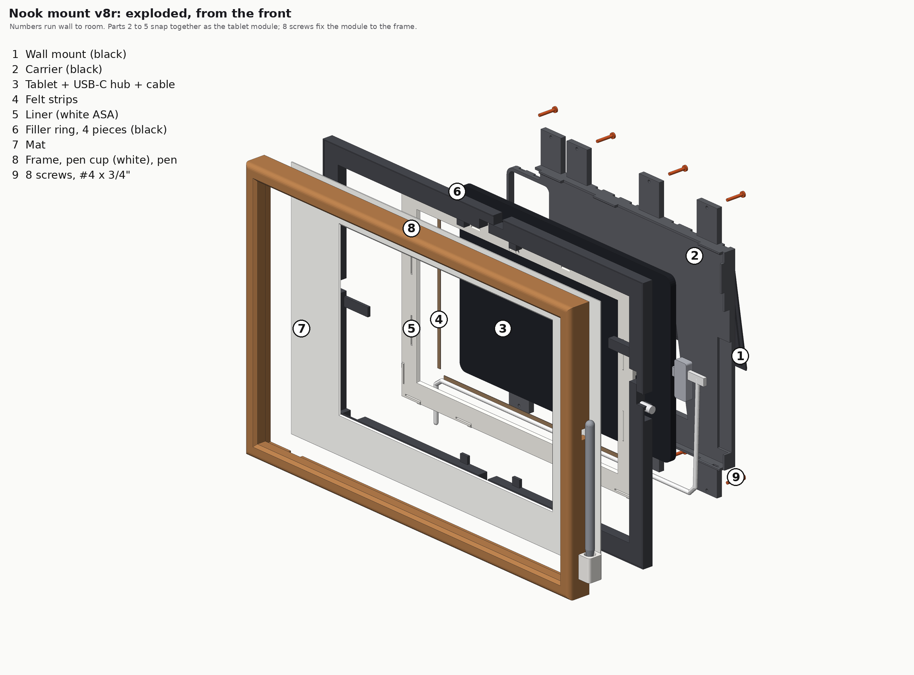
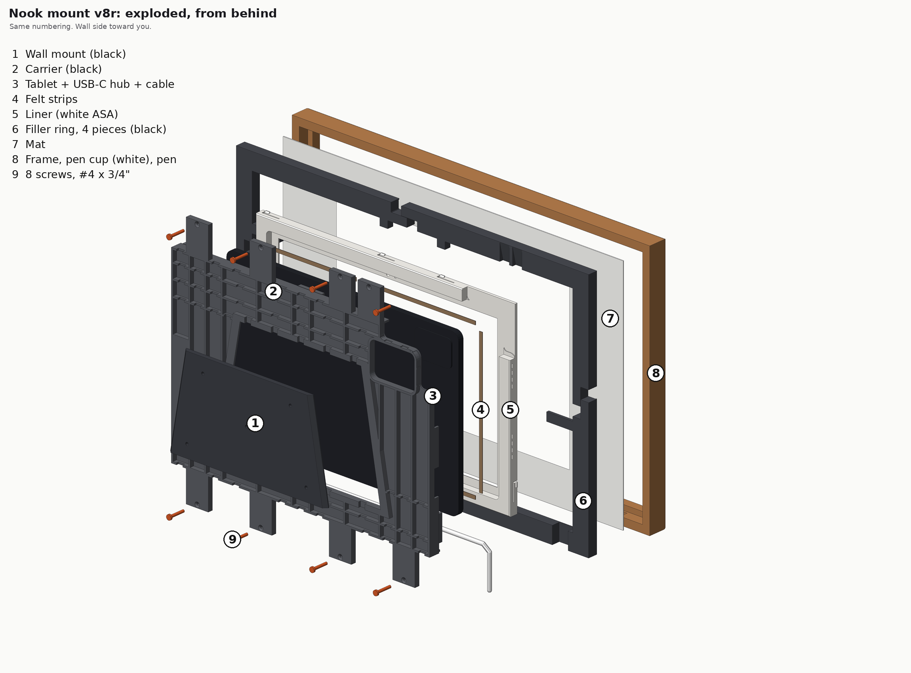

# Nook mount: a tablet hidden in a picture frame

A 3D-printed mount that puts a **Lenovo Idea Tab Pro 12.7" (TB373FU)** inside an ordinary **11 × 17" teak picture frame**, so it hangs on a drywall wall like a framed print. The tablet shows a family calendar; a white mat and a printed liner hide the bezel; the stylus lives on a magnetic charger on the side of the frame; power comes in through a USB-C socket at the bottom edge.



> ## Status: designed and checked, **not yet built**
> The v8r files were sent to a print service on 2026-11-14 and the parts have not arrived. **No test prints exist.** Everything below is verified in CAD (see `docs/PRINTING.md`) but not on real parts. Anything marked *unproven* may need a hand fix. This README will be updated after the first build, including what went wrong.

## What it is

- **Tablet module:** a printed *liner* (white, visible), felt strips, the tablet, and a printed *carrier* (black) snap together with 9 small spring snaps.
- **Frame side:** the teak frame, its mat, and a four-piece printed *filler ring* that fills the rabbet where the backing board used to sit.
- **8 screws** (#4 × 3/4") go through ears on the carrier into the back of the frame. The frame then drops onto one **wall mount** (45° hooking edges, five anchors).
- **Pen dock:** a magnetic pen charger is glued into a tunnel in the ring and pokes out through an 11 mm slot you drill in the right side of the frame. A small white printed cup holds the pen's lower end.
- **Power:** a right-angle USB-C extension. Its female end is glued into the ring at the bottom left of the frame, so the socket is fixed and the cable never pulls on the tablet.
- **Buttons:** reachable from behind with the unit off the wall (a corner of the carrier and liner is cut away).
- **Sound:** microphones and speakers work through narrow slots in the liner's face, hidden behind the mat edge. A plain liner without face speaker slits is included too.
- **Cameras:** small flared holes in the liner for the front camera and light sensor. The rear camera stays usable because its window is open.



## Repository layout

| Path | What |
|---|---|
| `stl/` | Print files (already in print orientation). |
| `docs/PRINTING.md` | Print settings, per-part notes, material notes. |
| `docs/BOM.md` | Everything to buy. |
| `docs/INSTALL.md` | Assembly order, frame drilling, gluing, bench tests. |
| `docs/MEASUREMENTS.md` | Measured tablet, frame, mat and pen dimensions. |
| `cad/` | Python (manifold3d) source for all the parts, the check suite, and the render scripts. |
| `images/` | Exploded views and print orientations. |

## Rebuilding the files

```
pip install -r requirements.txt
cd cad
python final_parts.py     # writes ../stl/*.stl and ../images/print_orientation.png
python deepcheck.py       # full print and fit check (several minutes)
python exploded_v8r.py    # the exploded renders
```

`model.py` holds every dimension as constants at the top. It is written for this tablet and this frame, not as a general tool; adapting it to another tablet or frame means editing those constants and re-running `deepcheck.py`.

## Known issues and open questions

- **Unproven:** sound slots 1.2 mm wide on the liner's bed face (they may close up or string); whether the 3.0 mm white face fully hides the black bezel; the exact tone of the printed white against the mat; camera and light-sensor performance through the small holes (the light sensor will read dim); the right-angle USB-C plug orientation and female-end size (the ring tunnel is 100% infill so it can be trimmed).
- **Hub retention:** the 2-in-1 adapter plugged into the tablet is a loose fit in the tablet's USB-C port, and a small nudge can interrupt charging. The design has felt shims above and below the adapter but no positive lock. If you build this, test the adapter by hand first; a different adapter or a printed retainer may be needed.
- **Thin spot:** the carrier strip beside the power button is about 2.2 mm wide.
- **ASA vs PETG white:** see `docs/PRINTING.md`.
- **Tablet charge limit:** if the tablet has no charge limit, a smart plug may be needed to protect the battery in always-on use.

## License

Source code (`cad/`, `requirements.txt`): MIT, see `LICENSE`.
Designs, STL files, images and documentation: Creative Commons Attribution-ShareAlike 4.0, see `LICENSE-DESIGN.md`.
Lenovo, Heimlove, Statik and Directlinx are named only to say what the parts fit; this project is not affiliated with or endorsed by any of them.
